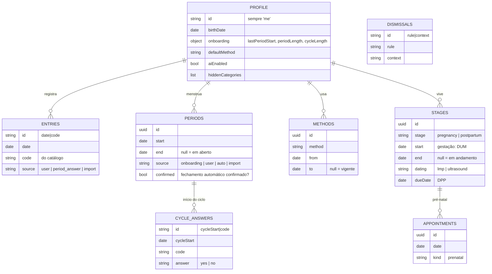

# Modelo de dados

Banco local (IndexedDB `ciclo`, versão 1) do PWA. Código: `src/data/schema.js`.
Decisões de arquitetura: `docs/adr/0001-arquitetura-mvp.md`.

## Princípios

1. **Guardar fatos, calcular o resto.** Só gravamos o que a usuária informou. Ciclos, médias, fases,
   previsões, regularidade e alertas são **calculados** em `src/domain` a cada abertura.
2. **Cifrado e sem índices.** Cada registro vira `{id, iv, data}` cifrado; só o `id` fica legível.
3. **Pronto para sincronizar.** Todo registro tem `updatedAt` e `deletedAt` (lápide).
4. **Mínimo necessário.** Nada de nome, e-mail, foto, desfecho da gestação ou "não lembro".

## Diagrama

Todos os stores têm também `updatedAt` (data-hora ISO) e `deletedAt` (null se ativo).

## Stores

| Store | Chave | O que guarda | Regras |
|---|---|---|---|
| `profile` | `'me'` | Nascimento, onboarding, método padrão, IA ligada, categorias escondidas | Recusa `name`, `email`, `phone`, `photo`. Idade é calculada, não gravada. |
| `entries` | `date\|code` | Um registro por ícone marcado num dia | Toque liga/desliga via `deletedAt`. `code` precisa existir no catálogo. Escolha única e negações são aplicadas antes de gravar (`applyTap`). |
| `periods` | uuid | Menstruações (início e fim) | Fonte da verdade do ciclo. O fluxo diário em `entries` é só intensidade. Aberta há 10+ dias: fechada pela média com `source: 'auto'` até ela confirmar (RF01.4). |
| `methods` | uuid | Método contraceptivo com vigência | Trocar fecha o vigente no dia anterior; o passado não é reescrito (RN01). |
| `stages` | uuid | Gestação e pós-parto | Só datas e método de datação. **Recusa `outcome`.** Ciclos que cruzam um estágio saem das médias. |
| `cycleAnswers` | `cycleStart\|code` | "Teve cólica nesta menstruação?" | Só `yes`/`no`. "Não lembro" não é gravado e mantém o ciclo como sem registro. |
| `appointments` | uuid | Consultas do pré-natal | — |
| `dismissals` | `rule\|context` | Alertas já vistos | Ex.: `pds|2026-10-17` para não repetir o alerta da PDS no mesmo ciclo. |

## O que é calculado (nunca gravado)

| Dado | Onde |
|---|---|
| Ciclos, médias (sem o ciclo fora do padrão), janela de previsão, fase do dia | `domain/cycles.js` |
| Regularidade em dois tons, pausa pós-gestação | `domain/regularity.js`, `domain/rules.js` |
| Teve / não teve / sem registro, "X de Y ciclos" | `domain/observation.js` |
| Idade gestacional, trimestre, DPP, aviso de DUM recente | `domain/stages.js` |
| Alertas da PDS (RN04) e sinais de alerta da gestação | `domain/rules.js` |
| Itens visíveis por estágio e semana de gestação | `domain/catalog.js` |

## Exclusão de dados

1. Apaga todos os stores do aparelho e a chave de criptografia.
2. Antes disso, pode gerar um registro anônimo com `buildAnonymousRetention` (`domain/privacy.js`):
   idade em anos, durações de ciclo e menstruação ordenadas, contagem de sintomas e humor por fase.
   Sem datas, sem vida sexual, PDS, testes, gestação ou alertas.
3. Enquanto não houver servidor, esse registro não sai do aparelho. Quando houver, vai para uso interno,
   nunca para terceiros.

## Para a IA (próxima fase)

A IA recebe só o que a pergunta precisa, sem identificação: eventos com código e data, ou os números
já calculados pelo domínio. Nunca o perfil, nunca o desfecho de gestação (que nem existe no banco).
